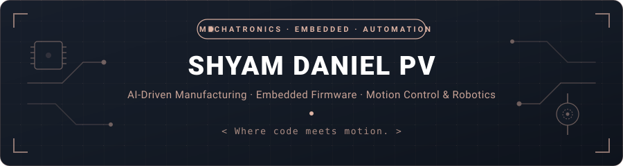

  

  

  

  
  
  

### 🎓 About

I'm a B.E. Mechatronics Engineering student at **SNS College of Technology**, Coimbatore (2024 - 2028).
I'm looking for an internship where I can work on AI-driven manufacturing and embedded control, using Arduino, ESP32 and Raspberry Pi. I'm especially drawn to motion control and electronics integration.

### 🛠️ Selected Work

<table>
  <tr>
    <td width="50%" valign="top">
      <b>🦾 Prosthetic Arm</b> &nbsp;Featured · Completed  
      Sensors and embedded control combined to restore basic hand movement. My role covered sensor integration, testing and prototype development.
    </td>
    <td width="50%" valign="top">
      <b>🤖 Robotic Arm</b> &nbsp;Completed  
      Actuators, sensors and embedded control integrated into a working arm. My role covered design, programming, testing and prototyping.
    </td>
  </tr>
  <tr>
    <td width="50%" valign="top">
      <b>📡 Ultrasonic Radar</b> &nbsp;Completed  
      Real-time object detection and distance measurement with a microcontroller and ultrasonic sensor, with live visualization.
    </td>
    <td width="50%" valign="top">
      <b>🔐 Certify Secure</b> &nbsp;Completed  
      Blockchain-based system for tamper-proof certificate issuing and real-time verification.
    </td>
  </tr>
  <tr>
    <td colspan="2" valign="top">
      <b>📝 Assignment Submission App</b> &nbsp;Completed  
      An app where students submit assignments and faculty receive and review them.
    </td>
  </tr>
</table>

### 🧰 Toolkit

#### 💻 Languages

  

#### 🪛 Embedded and hardware

  

  
  
  
  
  
  

#### 🧪 Tools and simulation

  

  

#### ☁️ Cloud and AI

  

#### 🗃️ Learning now

  

  Inverse kinematics (DH parameters) · ISO 10218 robot safety

### 💼 Experience

<table>
  <tr>
    <td width="30%" valign="top"><b>🏭 B Touch Ind</b> Coimbatore</td>
    <td valign="top">Prosthetic arm development with sensors and signal integration. Served as Software Team Manager, leading coordination and project execution.</td>
  </tr>
  <tr>
    <td valign="top"><b>🏭 Frank Technologies Pvt. Ltd.</b> Dec 2025</td>
    <td valign="top">Exposure to air compressor manufacturing and core industrial processes.</td>
  </tr>
  <tr>
    <td valign="top"><b>🏭 Shabari Impex Industry</b> Jul 2025</td>
    <td valign="top">Injection moulding operations, mould design, material handling, quality inspection and automation.</td>
  </tr>
</table>

### 🏆 Recognition and Leadership

- 🥇 Winner, **Chennovate 2.0** Hackathon
- 🥇 Winner, **Odyssey 3.0** Hackathon
- 🎖️ Smart India Hackathon, inter-college level
- 🎖️ Vice President, **IETE Students Forum**
- 🎖️ Executive Member, **Tronexus** Mechatronics Engineering Association and **Robotics Club**
- 📜 Certifications: Microsoft Azure AI Fundamentals · IBM Design Thinking Practitioner · MATLAB Onramp
- 🗣️ Languages: English · Tamil · Malayalam (speaking)

### 📬 Contact

Hiring for embedded, robotics or automation? I'd be glad to talk.

- ✉️ Email: [shyamzzz2922@gmail.com](mailto:shyamzzz2922@gmail.com)
- 🔗 LinkedIn: [linkedin.com/in/shyamdaniel](https://www.linkedin.com/in/shyamdaniel)
- 📞 Phone: [7010519600](tel:+917010519600)

<i>Where code meets motion.</i>

